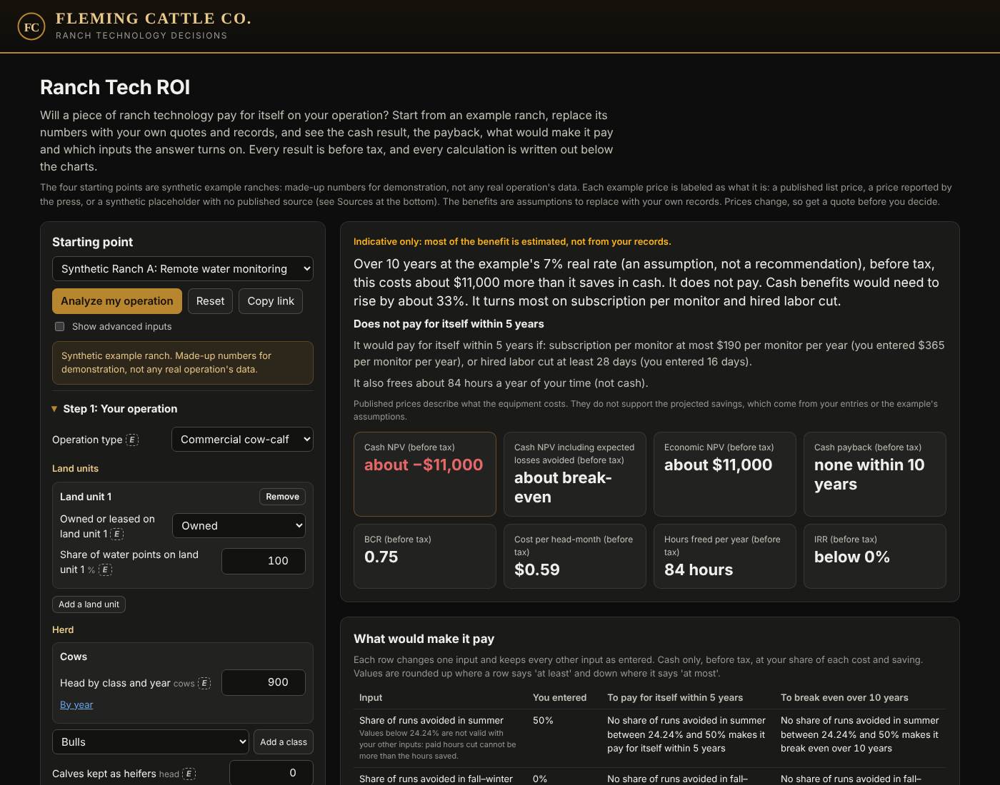
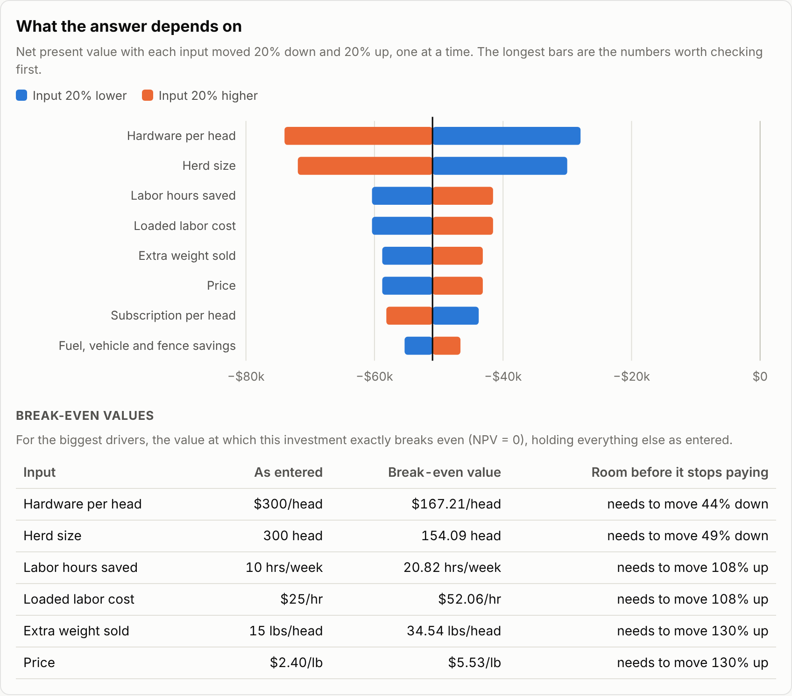

# Ranch Tech ROI

A calculator for the question every ranch asks before buying new technology: **will it pay for itself here?**
Pick a starting point (collar-based virtual fencing, remote water monitoring, or EID tags and a scale), replace the numbers with
your own quotes and records, and it shows the payback, the net present value, and which assumptions the answer really
depends on. Every number on the page is calculated in the open, with the formula and the values that went into it.

**Try it:** https://cowcampstx.github.io/ranch-tech-roi/ (runs in the browser; nothing is uploaded or saved).



> Synthetic example ranch. Made-up numbers for demonstration, not any real operation's data. Of the starting costs,
> only the water monitor's is a published price (a dealer's undated flyer). The virtual fence costs are vendor
> statements reported by the press and a figure from university comparison slides, not published list prices, and the
> EID costs have no published source (see Sources below). The benefits are assumptions. Use your own quotes and
> records for a real decision.

## What it answers

| Question | Where on the page |
|---|---|
| Does it pay, and how soon? | Verdict line, net present value, payback, internal rate of return, return on cost |
| What does it cost per head, all in? | All-in cost per head per year |
| Which of my assumptions matter most? | Sensitivity chart: each input moved 20% down and up, longest bars first |
| How wrong can I be before it stops paying? | Break-even table: the value of each key input where NPV hits zero |
| What if two things change at once? | Two-way table for the two biggest drivers, from 40% below to 40% above |
| Where does each number come from? | Year-by-year table and the written-out formulas |

A scenario can be shared: **Copy link to this scenario** puts every input in the link.



## The model

Year 0 is the purchase. Years 1 to N are operating years. N, "Years analyzed", is a whole number of years, 1 or more;
any other value shows an error and nothing is calculated. Each starting point uses 5 years, the fallback when no
contract term or asset life is known, and says so beside the input.

| Line | Formula |
|---|---|
| Hardware | herd size × hardware per head |
| Upfront cost (year 0) | hardware + base station, setup and install |
| Running cost (each year) | herd × subscription per head + hardware × repairs % + hardware × devices replaced % |
| Labor benefit | hours saved per week × 52 × loaded labor cost per hour |
| Death loss benefit | herd × death loss avoided (% of herd) × value per head |
| Weight benefit | herd × extra pounds sold per head × price per pound |
| Full-year benefit | labor + death loss + weight + fuel, vehicle and fence savings |
| Year 1 benefit | full-year benefit × share realized in year 1 (the crew is still learning the system) |
| Net cash | benefit − cost for each year |
| NPV | Σ net<sub>t</sub> ÷ (1 + discount rate)<sup>t</sup>, t = 0…N |
| IRR | the discount rate where NPV = 0 (found by bisection) |
| Payback | years until cumulative net cash ≥ 0, interpolated within the year |
| Return on cost | (total benefit − total cost) ÷ total cost |
| Sensitivity | NPV with one input at −20% and +20%, everything else held as entered |
| Break-even | the value of one input where NPV = 0, searched from 0 to 10× its current value |

Not included, on purpose, to keep it readable: taxes and depreciation, financing, resale value at the end, and price
changes over time. They can be folded into the inputs (for example, a lower hardware cost to reflect resale).

## The new engine (being built)

`roi.js` holds the engine that phase 1 builds one step at a time from the specification in
[`docs/audit/phase1-spec.md`](docs/audit/phase1-spec.md) (sections 9.2 and 9.3). The page moves to it in the last
step and runs on today's model, `v1.js`, until then. Money is in today's dollars, before tax, at a real discount rate,
over years 0 to T. Built so far:

| Part | Rule |
|---|---|
| Cost lines | Each cost is its own line: capital (bought) or annual (billed each season), with a quantity that is fixed (1) or per device. A blank price is not counted and is listed as "Quote required", unless the line has no quantity in any year. A blank start year or billing takes the default. |
| Capital purchases | Bought in the line's start year s. Each later rise in quantity is a new group of devices, counted against the largest quantity so far (for items that leave with the animal, against the year before). Each group is bought again every L years, its life, while that year is before T; with no life entered, it is bought once. |
| Repairs | repair % × the purchase's cost, in each year the purchase is in service |
| Residual at T | from each group's last purchase: straight line, cost × (life left at T ÷ L), between 0 and 100%; none; a % of cost; or a dollar amount for the whole line. It is its own series, R. |
| Annual lines | Season t (t = s + 1 … T) costs that season's price × quantity, billed in year t − 1 in advance (the default for subscriptions and service fees) or in year t in arrears. Inside a commitment the billed quantity is at least the minimum; a commitment that runs past T charges its early-termination fee in year T. |
| Labor cut (cash) | Only when the freed time replaces paid work: units cut × hours per unit × pay rate × (1 + payroll load), or units cut × salary × (1 + load) for a position. Until that question is answered the time is "absorbed" and counts as no cash. The paid hours cut cannot be more than the hours saved. |
| Avoided hire (cash) | salary × (1 + load) in each year of a planned hire that is not made |
| Added hours | Paid: hours × pay rate × (1 + load), a cost in the year they are worked. Unpaid: they lower the hours freed. A single number recurs in each operating year; hours given by year put setup time, such as install, in the start year. |
| Hours freed (capacity) | hours saved − paid hours cut − unpaid hours added, in hours, valued at the owner's time rate in the economic view only, never as cash |
| Results | net cash N = cash benefits + residual − costs; cash NPV = Σ N<sub>t</sub> ÷ (1 + r)<sup>t</sup>; benefit-cost ratio = (PV of cash benefits + PV of residual) ÷ PV of costs; IRR and payback on N, as today |

## What the example shows

Synthetic example ranch. Made-up numbers for demonstration, not any real operation's data. The example counts saved
hours and assumed weight gain as cash, so its results are not cash results: payroll changes only if someone is paid
less or not hired, and the weight gain is applied to the whole herd at the sale price per pound. The sensitivity chart
and break-even table show which assumptions the answers lean on, which is the conversation a ranch manager and a
vendor would actually have. A plan to make the results cash results is in [`docs/audit/`](docs/audit/).

## Sources

Each cost in the starting values is listed below as what it is: a published dealer price, a vendor statement reported
by the press, a figure from university comparison slides, or a placeholder with no published source. They are listed
for transparency and are not endorsements of any product, and the benefit values are assumptions, not vendor claims.

- Collar-based virtual fencing: $4,500 one-time infrastructure and a subscription under $7 per head per month, collars
  included. Vendor statements reported by the press, not published list prices.
  [DTN/Progressive Farmer, 31 March 2025](https://www.dtnpf.com/agriculture/web/ag/news/article/2025/04/01/virtual-fencing-ranchers-new-best)
- Virtual fence base stations at $3,000 each. A figure from university comparison slides, given when the slides said
  those collars were "not yet available" in the US, so not a published US price.
  [Virtual fence manufacturer comparison, Rangelands Gateway, 16 April 2024](https://rangelandsgateway.org/sites/default/files/users/user14/VFCompanyComparison.pdf)
- Remote water monitoring: $1,490 per satellite water-level monitor and $365 per monitor per year. A published dealer
  price. [Water monitor dealer flyer (All-Tex Irrigation), undated; checked 15 October 2026](https://www.alltexirrigation.com/storage/UserFileFolder/Ranchbot_Flyer_-_All-Tex.pdf)
- EID tags and scale: $4 per tag, $12,000 for the reader, scale and setup, and $1 per head per year. No published
  source: placeholders to replace with your quotes.
- Physical fence at about $15,000 per mile to build and 2% a year to maintain.
  [New Mexico State University Extension, B-133](https://pubs.nmsu.edu/_b/B133/index.html)

## Run it locally

No build step and no dependencies. The page uses JavaScript modules, so serve the folder instead of opening the file:

```bash
python -m http.server 8000      # then open http://localhost:8000
node --test tests/*.test.mjs    # 50 tests. v1.test.mjs (15): today's model, its hand-checked case, the horizon
                                # rule and the wording of the sources. roi.test.mjs (35): the phase-1 engine's
                                # cost lines, billing, labor and validation, the same hand-checked
                                # case, and Synthetic Ranch A's pinned cash NPV
```

## Files

```
index.html        the page and its styles (light and dark mode, works on a phone)
app.js            page wiring: inputs, charts, tables, written-out formulas
v1.js             today's model, which the page runs on: pure functions, no dependencies, shared with the tests
roi.js            the phase-1 engine, being built step by step (see "The new engine" above); the page does not use it yet
tests/            node:test unit tests, including a small case checked by hand
docs/             screenshots
docs/audit/       the audit and improvement plan, and the phase-1 specification
```

## License

MIT
