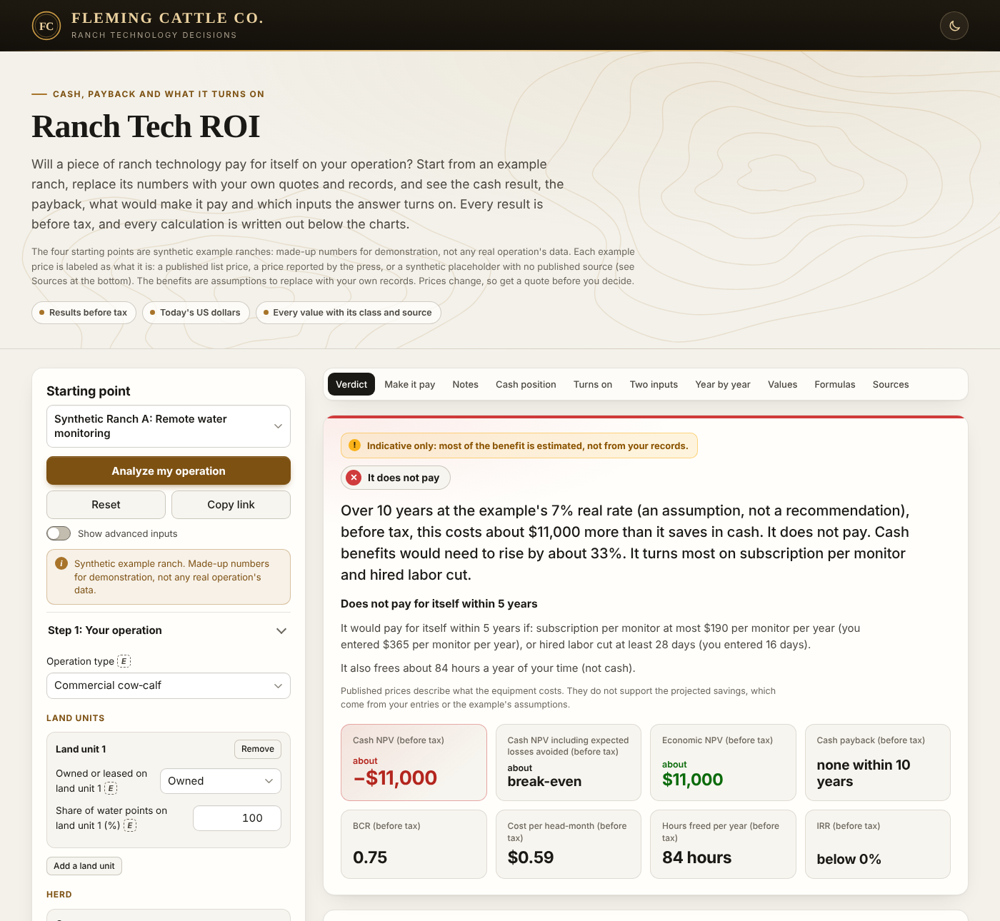
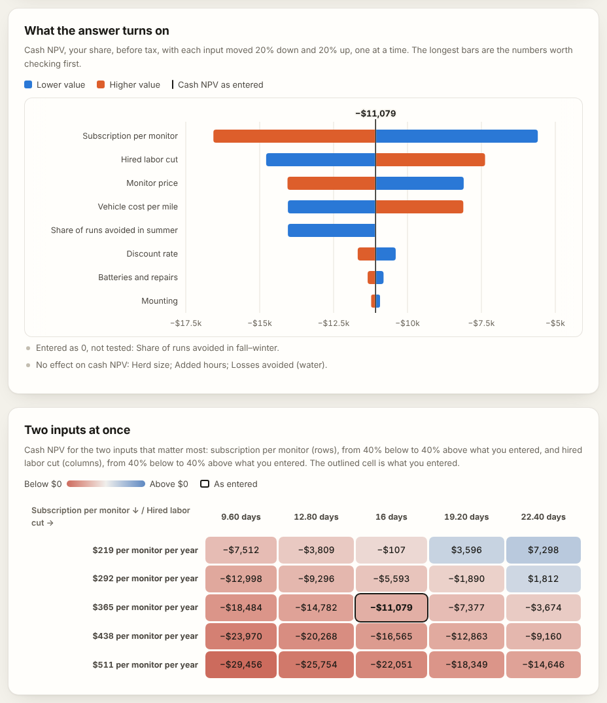

# Ranch Tech ROI

A calculator for the question every ranch asks before buying new technology: **will it pay for itself here?** It
covers remote water monitoring, virtual fencing, and EID tags with a reader and scale. Start from one of four synthetic
example ranches, replace the numbers with your own quotes and records, and it shows what the technology does to your
cash before tax, whether it pays for itself within your payback target, what would have to be true for it to pay, and
which assumptions the answer really depends on. Every number on the page is calculated in the open, with the formula,
the values that went into it, and where each value comes from.

**Try it:** https://cowcampstx.github.io/ranch-tech-roi/ (runs in the browser; nothing is uploaded, and only
your choice of light or dark theme is remembered, in this browser).



> The four starting points are synthetic example ranches: made-up numbers for demonstration, not any real operation's
> data. Each example price is labeled as what it is: a published list price, a price reported by the press, or a
> synthetic placeholder with no published source (see Sources below). The benefits are assumptions to replace with
> your own records. Every result is before tax. Prices change, so get a quote before you decide.

## What it answers

| Question | Where on the page |
|---|---|
| Does it pay, before tax? | The verdict, and the tiles: cash NPV, cash NPV including expected losses avoided, economic NPV, cash payback, benefit-cost ratio (BCR), cost per head-month, hours freed and IRR |
| Does it pay for itself within my payback target? | The line under the verdict (5 years unless you change the target) |
| What would have to be true for it to pay? | "What would make it pay": for each driver, the value at which it pays within the target and over the whole horizon |
| Which of my assumptions matter most? | "What the answer turns on": each input moved 20% down and up, widest bars first |
| What if two things change at once? | "Two inputs at once": cash NPV for the two widest bars, from 40% below to 40% above |
| How much of the answer is estimated? | "Indicative only" in the verdict, a class badge (A to E) on every value, and the list of what was left out |
| Who pays and who gains? | Every result is your share; amounts paid or received by a landlord or others are listed apart |
| Where does each number come from? | The year-by-year table, the written-out formulas, every value with its class and source, and the sources |

**Analyze my operation** makes the analysis yours: the example's banner goes, and the page asks you to review the
discount rate and to replace or confirm each synthetic placeholder. **Copy link** puts the scenario in the link (only what
differs from the example). Links made with the version 1 page still open, converted, with a banner naming what changed.
The bar above the results jumps to each part of them and keeps the cash NPV in view as you scroll; the page follows
your device's light or dark setting, and the button at the top right switches it. A printout shows every value and every
formula section, in the light theme.



## The model

Money is in today's US dollars with prices held flat, so the discount rate is a real rate (real rate ≈ your loan rate
+ a risk premium − expected inflation); the examples use 7%, an assumption to review, not a recommendation. Every
result is before tax. Year 0 holds purchases and fees billed in advance; years 1 to T are operating years, with their
costs and benefits at the end of each year, except the avoided fence, which counts in the year it would have been
built. T, the horizon, and the payback target are whole numbers of years from 1 to 50. Results are the operator's
share; amounts paid or received by others are listed apart and never enter a result.

Every value has a class, shown as a badge: **A** official statistics, **B** research or extension, **C** vendor
information (a published list price, or a vendor price reported by the press), **D** your entry, **E** a made-up
example value (an operating assumption or a synthetic cost placeholder). A published price describes what the
equipment costs; it never supports a projected saving.

`roi.js` holds the model as pure functions with no dependencies, built from the specification in
[`docs/audit/phase1-spec.md`](docs/audit/phase1-spec.md) (sections 9.2 and 9.3).

### Costs

| Part | Rule |
|---|---|
| Cost lines | Each cost is its own line: capital (bought) or annual (billed each season), with a quantity that is fixed (1), per device, or taken from head counts (below). A blank price is not counted and is listed as "Quote required", unless the line has no quantity in any year. A blank start year or billing takes the default. |
| Capital purchases | Bought in the line's start year s. Each later rise in quantity is a new group of devices, counted against the largest quantity so far (for items that leave with the animal, against the year before). Each group is bought again every L years, its life, while that year is before T; with no life entered, it is bought once. |
| Repairs | repair % × the purchase's cost, in each year the purchase is in service |
| Residual at T | from each group's last purchase: straight line, cost × (life left at T ÷ L), between 0 and 100%; none; a % of cost; or a dollar amount for the whole line. It is its own series, R. |
| Annual lines | Season t (t = s + 1 … T) costs that season's price × quantity, billed in year t − 1 in advance (the default for subscriptions and service fees) or in year t in arrears. Inside a commitment the billed quantity is at least the minimum; a commitment that runs past T charges its early-termination fee in year T. |

### Benefits and hours

| Part | Rule |
|---|---|
| Labor cut (cash) | Only when the freed time replaces paid work: units cut × hours per unit × pay rate × (1 + payroll load), or units cut × salary × (1 + load) for a position. Units cut entered by year count from the first operating year, and the page says so. Until the question of what happens to the freed time is answered, the time is "absorbed" and counts as no cash. A paid cut needs its unit (hours, days, weeks or a position), which has no default: units cut above 0 with no unit is an error, and the hours per unit count only once a unit other than the hour is chosen. The paid hours cut cannot be more than the hours saved, and they shrink with them in a year without cattle, when a claim is counted only up to its baseline, or when a shared claim is scaled down. |
| Avoided hire (cash) | salary × (1 + load) in each year of a planned hire that is not made |
| Added hours | Paid: hours × pay rate × (1 + load), a cost in the year they are worked. Unpaid: they lower the hours freed. A single number recurs in each operating year; hours given by year put setup time, such as install, in the start year. On the water page an item named "install" is entered as one install time, kept in the start year's entry with 0 in the next year (it waits in year 0 while the start year or the horizon is an error); hours typed as one number before the item is named install become its install time. Install hours entered by year, in any year, stay as entered and show by year, also when the start year or the horizon changes. An item with no name is called "added item" with its number. |
| Hours freed (capacity) | hours saved − paid hours cut − unpaid hours added, in hours, valued at the owner's time rate in the economic view only (0 while no rate is entered), never as cash. The tile and the verdict's hours line show the average over years 1 to T; setup hours in year 0, such as install, appear only in the year table. |
| Head-months | Virtual fence: enrolled head × months enrolled, by class. Water and EID: head × months on the served pastures (12 by default), over the served classes. Calves sold and cull cows sold are sale flows drawn from other classes and never count. |
| Head-based quantities | Per head-month: the head-months of the line's classes. Per head-year: their head × 12, with a warning when they are enrolled or served for fewer months; a committed minimum is then 12 × the minimum head. Per device from a class (such as calf tags): that class's head, and a purchase in year t buys for the season that ends at t + 1. |
| No cattle | In any year after year 0 with no head-months, every benefit that needs cattle and the hours freed are 0, and the page says "No cattle in year t: benefits not counted." Costs are not zeroed: head-based ones fall to 0 on their own, and committed minimums are still billed. |
| Shared savings | Each saving claims a physical quantity: water runs, moving and gathering hours, death loss by cause, or interior fence miles. A claim above the ranch's own baseline (runs today, hours today, losses on record, fence in the plan) is counted only up to it, with a warning; when the baseline is blank, the page asks for it. The baseline is split by land unit like the claims: in each year it counts only the units whose part still counts (owned units, leases not yet ended and leases expected to renew), and the fence's baseline follows the fence's own land unit. When two technologies claim the same quantity, each claim is scaled by baseline ÷ total claimed (at most 1), with a warning naming both, and the hours those claims save, with the paid hours cut they support, scale with them. When the analyses report different baselines for one quantity, the largest is used, with a warning. |
| Weight gain | lb a day × days × head sold × value of gain, over the sold classes (calves sold, cull cows sold, and yearlings × the share sold). Value of gain is dollars per pound added, not the sale price per pound; from two weight-class quotes it is (W<sub>heavy</sub> × P<sub>heavy</sub> − W<sub>base</sub> × P<sub>base</sub>) ÷ (W<sub>heavy</sub> − W<sub>base</sub>), with the heavier weight above the base weight. It counts in the economic view only, unless it comes from the ranch's own records, when it is cash. |
| Losses avoided | events a year × head per event × share caught × value per head, claimed against that cause's death loss (the lines of one cause share one baseline). An expected loss, never cash: it enters "cash NPV including expected losses avoided" and economic NPV, never cash NPV, BCR, IRR or payback. Water's optional losses from fewer physical checks subtract the same way. Each line is named for its cause, with its class when another line has the same cause; lines that would still share a name add their number ("Losses avoided (water, cows), line 2"). |
| Ramp | A benefit line's claim in the module's first three operating years (years s + 1 to s + 3) is multiplied by ramp[1], ramp[2] and ramp[3] (1 by default; a value above 1 is set to 1, and a cleared entry counts as 0), and is full from year s + 4 on. Every part of the hours saved is ramped, and the paid hours cut and hours freed follow them; costs and the avoided fence are not ramped. |

### The three technologies

| Part | Rule |
|---|---|
| Water monitoring | For each season block, runs avoided = runs a week × weeks × share avoided, where the share used is at most (runs a week − minimum visits a week) ÷ runs a week. A block flagged for freezing or the feeding route counts 0 unless a share is typed, with a warning, and a share typed above the cap is counted at the cap, with a warning. The runs avoided are the claim on water runs. Vehicle (cash) = runs avoided × miles per run × variable cost per mile; hours saved = runs avoided × hours per run, the miles and hours per run averaged over the blocks by runs avoided. The monitors, subscription and batteries lines count the monitors. |
| Virtual fence | The pricing model picks the lines: leased collars carry a subscription on the enrolled classes; purchased collars are bought for the enrolled head, with a service fee per collar in use billed in advance. Other lines, such as infrastructure or base stations, are entered as quoted. Collar batteries = batteries per collar × collars, and collar loss = loss % × enrolled head × charge per collar, each billed in arrears. The moving and gathering hours cut are the claim on gathering hours; health-check riding hours cut add to the hours saved, but support paid hours cut only with a validated alert function. The fence the virtual fence replaces is the interior fence line above. |
| Interior fence | Avoided: the cost of the fence the ranch would build, F × miles in build year k, rebuilt every Lf years, with upkeep m × cost a year, less its straight-line residual at T. Deferred by d: that stream less the same stream starting in year k + d. It lies whole on its own land unit: a landlord-built fence is the landlord's saving, its whole stream listed under "Received by others". A lease ending at T' with no renewal expected stops the stream at T': when the tenant builds, the lease's fence reimbursement is its residual there, and a landlord-built fence keeps its straight-line residual at T'; and a landlord who maintains it makes the upkeep 0. Its purchases count if the module has cattle in some year; its upkeep only in years with cattle. |
| EID tags and scale | Cow tags are bought per cow (they leave with the animal), calf tags per calf born each season, and retags = retag % × the cows' head each season, all at the tag price; the calf tags and retags are billed in arrears. Free tags: in each listed billing year, up to the free quantity costs $0, going to cow tags, then calf tags, then retags, with no carry-over. Net program premium (cash) = calves sold × (sale weight in cwt × premium per cwt − verification fee). Dosing savings (cash) = Σ over classes of head × applications a year × saving per application. Recording time today is hours saved. Whether the EID rule applies is recorded for the cows and other inventory classes; until the rule's status is verified, every tag stays a project cost and the page says so. |
| Handling hours | Virtual fence and EID: Σ over the handling events of times a year × head of its classes × minutes per head × crew ÷ 60, plus gathers × riders × hours per gather, plus training days × riders × hours per day, in each operating year with cattle. Done by a paid hand they are a cost at pay rate × (1 + load); otherwise they lower the hours freed. |

### Who pays

| Part | Rule |
|---|---|
| Land units and who pays | Each water and virtual fence line is split across the land units by their share of head-months or water points (EID lines are not split). For each unit's part, the operator's flow is the operator share (1 unless changed) × the flow; the rest is listed as paid or received by others and never enters a result. On a lease that ends within the horizon with no renewal expected, that unit's part of each benefit stops at the lease end; an improvement that stays with the land stops there too, with its share of the lease reimbursement as its residual. Where the landlord provides and checks the water, or water care is in the lease rate, the vehicle, labor and hours-freed savings there go to the landowner by default. |

### Results

| Part | Rule |
|---|---|
| Results | The operator's share only. Net cash N = cash benefits + residual − costs; cash NPV = Σ N<sub>t</sub> ÷ (1 + r)<sup>t</sup>; cash NPV including expected losses avoided adds their PV; economic NPV adds the PV of losses avoided, capacity value and production. Benefit-cost ratio = (PV of cash benefits + PV of residual) ÷ PV of costs (n/a with no costs); cost per head-month = PV of costs ÷ PV of head-months in years 1 to T. Amounts under half a cent count as 0. |
| IRR | The rate at which the NPV of N is 0, found by bisection from the first year with cash flows. It is n/a with no cash flows, with no outlay in that first year, or with more than one sign change; "below 0%" when the nets sum to less than 0; and stated as above the search range past 10,000%. |
| Payback | Counted from year 0: k − 1 + (−cumulative N<sub>k−1</sub> ÷ N<sub>k</sub>), where k is the first year from which cumulative N stays ≥ 0 through T. When the first cash flow comes after year 0, the text says so ("counted from year 0; the first cash flow is in year s₀"); when cumulative cash was positive and then negative again before k, a note says so. "None within T years" when cumulative cash is still negative at T; "no net outlay" when it is never negative. Discounted payback is the same on discounted N. |
| Verdict | It pays when cash NPV ≥ 0; when cash NPV < 0 but cash NPV including expected losses avoided ≥ 0, it pays only if the loss estimate holds; otherwise it does not pay. An analysis with no cash flows for the operator (every Cₜ, Bₜ and Rₜ under half a cent in every year) reads "No cash flows for you in this analysis" and never pays. When cash NPV < 0 and PV(B) > 0, the verdict gives the rise the cash benefits would need, f = (PV(C) − PV(R)) ÷ PV(B), as "about f-fold" (f ≥ 2, one decimal) or "by about p%" (p = (f − 1) × 100, whole, at least 1), and names the two widest bars of the sensitivity chart. It also carries "Discount rate not yet reviewed." and "Includes synthetic cost placeholders." while those apply to the user's own analysis. |
| Indicative only | A cash line is estimated when any input it multiplies is class B, C or E (a published price on a cost line never supports a benefit); the avoided fence also when its life, build year or, when deferred, years deferred are, and the vehicle line when a block's minimum visits set its share used. A capital line's residual is estimated when its line's inputs or its own are: the share of cost, the life of a straight-line residual, or the amount, which alone sets an amount residual. When the PV of the estimated cash lines and residuals is more than half of PV(B) + PV(R), the verdict opens with "Indicative only: most of the benefit is estimated, not from your records." |
| Rounding | The verdict amount and the three NPV tiles are rounded to the nearest $1,000 when any material input is class B, C or E, and to the nearest $100 when every material input is class A or D. An input is material when its line's PV, without its sign, is at least 10% of PV(B) + PV(R). An amount that rounds to $0 reads "about break-even" on a tile and "is within $500 of breaking even" in the verdict ($50 at the $100 unit). The year table, notices and lists show whole dollars at $100 or more and cents below, unrounded. |
| What was left out | Listed in the order of the inputs (the shared inputs first, then the module's). A benefit, risk or production line left blank is not counted and is listed once by name ("Losses avoided (water): not entered, not counted"). Any other blank input that counts as 0 in a line the analysis uses is listed once under its own label, unless it already left a listed line blank and no cost line counts it as 0: a cost input such as the retag rate or a residual's share of cost, the hours the technology takes, or the owner time rate ("Owner time rate: not entered, not counted") when some year frees or takes hours. A blank benefit, risk, production or hours-saved input adds "Benefits left blank are not counted, so they can only make this result look worse."; a blank cost input, the hours the technology takes, losses from fewer physical checks, the verification fee, and an owner time rate whose hours freed are worth 0 or less do not, since each lowers the result (or leaves it) when entered. A blank price is not counted and is listed as "Quote required: not counted", with the warning that the result then overstates the case. Blanks with their own meaning are not listed: the ramp, the shares, a life (one purchase), the fence miles in the plan, the moving and gathering hours today, and the months served. |
| Written-out formulas | Each cost and cash benefit line with its values filled in: a cash line in its first operating year, a paid added item in its year with the most cost (with the most hours while its cost is 0), a bought line with each purchase less any free tags ("(300 − 100 free) × $3.14"), a billed line with its quantity and price (head-months for a price per head per month) less any free tags. A benefit's ramp below 100% in that year, the operator's share below 100% (0% included, where nothing is counted), and what is left of the result after them (the land units' part, a lease's end, the baseline's cap) are shown as factors, so that the values shown multiply to the result. |
| Values by year | A value entered by year shows and fills years 0 to T, the years past the end of a shorter list carrying its last value. A horizon above 50 years (an error) shows and fills through year 50 only, so a list never outgrows a link. "By year" on a value that counts only in the operating years (hours the technology takes, training days, paid labor cut) gives 0 in years 0 to the start year. |
| Payback target (N-year test) | N is the payback target (5 years unless changed). The analysis is run again with the horizon set to N: the residual at year N is recalculated for straight-line residuals, while a residual entered as a % of cost or an amount is used as entered (an amount only on a line bought within the N years); a lease-end reimbursement keeps the share the full horizon gives it (a lease that ends after T and within N gets none); a contract that runs past year N charges its early-termination fee in year N; past year T every price and quantity carries its value in year T (a value entered by year for a year after T is not used). It pays when its cash NPV is ≥ 0. With no cash flows for the operator within N years (or a module that starts in year N or later), it neither pays nor fails. Notices the N-year run raises that the full run does not are listed under the panel. |
| What would make it pay | For each driver of the module (water: each block's share of runs avoided, vehicle cost per mile, hired labor cut, monitor price, subscription, herd size; virtual fence: interior fence miles, fence cost per mile, hired moving and gathering hours cut, subscription or service fee, herd size; EID: herd size, net program premium, tag price, reader and scale cost, added hours), the value at which the N-year test's cash NPV and the full horizon's cash NPV reach 0, one input changed at a time. Each driver has a range (its table range, widened to include the entered value), narrowed where other inputs make a value invalid (paid hours cut above the hours saved; a residual above the purchase's cost). The search is bisection, 100 halvings, between the range's ends; it gives "none" when no value in the range pays, "all" when every value does, the value with "at least" or "at most" otherwise, and n/a when the driver has nothing to act on (no head, no calves sold, no reader or scale cost, no added hours, freed time absorbed or pay not entered, or no cash flows within the test). A driver entered by year moves in proportion to its first operating year's value. Herd size scales every head count, the free tags and head-based minimums together. The verdict names up to two drivers with a value, the smallest relative change first, taken to 10 significant figures so that drivers which tie keep the table order (an entered 0 or blank last; a price left blank never). |
| Display of a driver's value | Money is whole dollars at $100 or more and cents below; percentages and miles two decimals; head, days and hours whole. "At least" values round up and "at most" values round down, so each value shown, entered as is, passes its test; when that rounding would leave the narrowed range, the value is shown unrounded to two decimals. |
| Sensitivity (tornado) | One entry per input that matters, by module: herd size and discount rate in every module; water: each block's share of runs avoided (from the share typed, up to its cap), vehicle cost per mile, hired labor cut, monitor price and subscription; virtual fence: hired moving and gathering hours cut, the interior fence's cost per mile, the subscription or service fee (by how the collars are paid for), and collar loss; EID: hired labor cut, net program premium (left out with no calves sold), tag price, retag rate, reader and scale cost and dosing savings; where entered, avoided hire and added hours (every module), weight gain (virtual fence and EID) and each risk line (water and virtual fence); and every other cost line with its own price that no entry above moves, in the unit the page gives it. Factors that only appear as a product (such as days × hours per day × pay rate) are one entry, moved on one factor and shown in $/yr ($ for the interior fence). Each entry is moved to 0.8 and 1.2 × its value (the lower value first, also for a negative value), one at a time, through the same linked moves as "What would make it pay" (herd size moves every head count with it); a value given by year moves every year in proportion. A moved value that would make the paid hours cut exceed the hours saved, or a residual exceed its purchase's cost, is set to the nearest value that does not. Each bar runs between the two cash NPVs; bars are sorted widest first (widths to 10 significant figures, ties in entry order). Collar loss entered as 0 is tested from 0% to 7%. Entries not drawn are listed under the chart: left blank, entered as 0 (any other), or with no effect on cash NPV (a bar under half a cent); a blank price on a line with no quantity in any year is not listed. The verdict names the top two bars. |
| Two-way grid | Cash NPV over the top two bars, each at 0.6, 0.8, 1, 1.2 and 1.4 × its value (or five steps across collar loss's 0% to 7% when it is entered as 0), with the same linked moves, the same cap on a share and the same nearest-valid rule; a cell whose two values are not valid together is n/a, and the note says when a value was capped or moved. The cell at the entered values is the cash NPV. |

Not included: taxes (results are before tax), financing (the lender's view comes later) and price changes (amounts are
in today's dollars with a real discount rate).

### Links

| Part | Rule |
|---|---|
| Horizon from a link | A version 2 link whose settings give no T takes the longest contract term among its cost lines; else the life of the capital line with the largest year-0 cost; else 5 years, with the note "5 years assumed: no contract term or asset life entered." Every example and every version 1 link sets T. The horizon and the payback target are whole numbers of years from 1 to 50. |
| Shared links | `links.js`. A link is `#v=2&m=<module>&x=<example>&s=<data>`, where the data is the URL-safe base64 of the UTF-8 JSON of what differs from the example: each changed part whole, a removed part as null, and each changed source record by its path. The payback target rides along only when it is not 5. Reading a link loads the example, applies the data, checks that every value has the shape the data model gives it (a number or blank, a list by year, one of a field's listed values, a list or set with only the data model's fields, a source record with its class, a discount rate, a timing and basis on each cost line, ids of letters, digits, `-` and `_`, and at most 51 entries in a list or set, a value for each year of the longest horizon), sets a negative number to 0 (and a ramp value above 1 to 1), names each such change in a banner, and checks the values as if typed; a link that cannot be read, or whose values give no finite result, opens Synthetic Ranch A and says so. A link from the version 1 page (no `v`) is converted: its values are mapped to the matching example's module (an unknown or missing technology opens the virtual fence and says so; the two brand names of the page just before 14 October 2026's last version, whose starting values were the same, are read as the technology they named), with the head as cows, the year-1 share as the ramp, labor hours as hours saved (capacity only), and its three costs as lines; the fields with no place in the new engine are named in the banner. |

## What the example shows

The four ranches are synthetic: made-up numbers for demonstration, not any real operation's data, and not the site
owner's operation. Their herd sizes differ (900 cows, 1,200 yearlings, 300 cows, 400 cows), and no example's inputs
were tuned to reach a result. Ranches A, B and D are set where the independent evidence gives the technology its best
chance; Ranch C is a mid-size cow-calf herd selling at a local auction, a common US setting. At the examples' 7% real
rate, before tax:

| Example | Cash NPV | Within 5 years | What it says |
|---|---|---|---|
| Synthetic Ranch A: remote water monitoring, 900 cows, 10 years | about −$11,000 | does not pay for itself | Close to break-even only if a synthetic outage-loss value is counted; cash alone falls short |
| Synthetic Ranch B: virtual fence, 1,200 yearlings, 7 years | about −$230,000 | does not pay for itself | Strongly negative in every scenario, including the optimistic one |
| Synthetic Ranch C: EID tags, reader and scale, 300 cows, 7 years | about −$10,000 | does not pay for itself | Mildly negative; positive only with a verified-program premium the ranch does not have today |
| Synthetic Ranch D: virtual fence, good fit, 400 cows, 7 years | about −$10,000 | does not pay for itself | Close to break-even and slightly negative even in a good fit; it turns on how much fence it really replaces |

The full cases, with every input, the three scenarios and the five-year test, are in section 11 of
[`docs/audit/ranch-tech-roi-audit.md`](docs/audit/ranch-tech-roi-audit.md), and the pinned numbers in Appendix A of
[`docs/audit/phase1-spec.md`](docs/audit/phase1-spec.md). The point of the examples is the conversation a ranch
manager and a vendor would actually have: which assumptions the answer leans on, and how far each would have to move.

## Sources

Each example value that is not a made-up assumption is listed below as what it is: official statistics [A], research
or extension [B], a published list price [C] or a vendor price reported by the press [C]. The synthetic cost
placeholders [E] are listed too, because they stand in for prices no one has published. Vendor information is listed
for transparency and is not an endorsement, and every benefit in the examples is an assumption, not a vendor claim. The
page builds the same list from the examples (`examples.js`), and the full evidence table is in
[`docs/audit/evidence-table.md`](docs/audit/evidence-table.md).

**Synthetic Ranch A** (remote water monitoring)

| Value | In the example | What it is |
|---|---|---|
| Pay rate | $18.72/h | Official statistics: [USDA NASS, Farm Labor (Northern Plains livestock workers, reference week 6–12 April 2025), 21 May 2025](https://esmis.nal.usda.gov/sites/default/release-files/x920fw89s/0v839z45n/sx61gj70t/fmla0525.txt) |
| Payroll load | 10% | Research or extension: [U.S. Bureau of Labor Statistics, Employer Costs for Employee Compensation (legally required benefits), 12 Sep 2025](https://www.bls.gov/news.release/archives/ecec_09122025.htm) |
| Monitor price | $1,490 per monitor | Vendor information: published list price ([All-Tex dealer flyer, undated; checked 15 Oct 2026](https://www.alltexirrigation.com/storage/UserFileFolder/Ranchbot_Flyer_-_All-Tex.pdf)). Not an endorsement. Replace with your quote. |
| Life (Monitors) | 10 years | Research or extension: [USDA NRCS, E614A enhancement sheet (enhancement life span 10 years), Sep 2024](https://www.nrcs.usda.gov/sites/default/files/2025-02/E614A%20-%20Adding%20telemetry%20to%20a%20watering%20facility%20to%20monitor%20water%20levels%20remotely_09-24.pdf) |
| Mounting | $750 | Synthetic placeholder, not a price. Replace with your quote. |
| Subscription per monitor | $365 per monitor per year | Vendor information: published list price ([All-Tex dealer flyer, undated; checked 15 Oct 2026](https://www.alltexirrigation.com/storage/UserFileFolder/Ranchbot_Flyer_-_All-Tex.pdf)). Not an endorsement. Replace with your quote. |
| Batteries and repairs | $100 per monitor in years 4 and 8, $0 per monitor in the other years | Synthetic placeholder, not a price. Replace with your quote. |

**Synthetic Ranch B** (virtual fence)

| Value | In the example | What it is |
|---|---|---|
| Pay rate | $25/h | Synthetic placeholder, not a price. Replace with your quote. |
| Pay rate (Handling labor) | $25/h | Synthetic placeholder, not a price. Replace with your quote. |
| Subscription | $7/head/month | Vendor information: reported price ([DTN, 31 Mar 2025](https://www.dtnpf.com/agriculture/web/ag/news/article/2025/04/01/virtual-fencing-ranchers-new-best)), not a published list price. Not an endorsement. Replace with your quote. |
| Infrastructure | $4,500 | Vendor information: reported price ([DTN, 31 Mar 2025](https://www.dtnpf.com/agriculture/web/ag/news/article/2025/04/01/virtual-fencing-ranchers-new-best)), not a published list price. Not an endorsement. Replace with your quote. |
| Fence cost per mile | $4,300/mi | Research or extension: [University of Missouri Extension, G1193 Pasture Fence Construction Budget, Feb 2024](https://extension.missouri.edu/publications/g1193) |
| Fence life | 4 years | Research or extension: [Iowa State University Extension, FM-1855 Estimated Costs for Livestock Fencing (Table 6), Dec 2024](https://www.extension.iastate.edu/agdm/livestock/pdf/b1-75.pdf) |
| Fence upkeep | 5%/yr | Research or extension: [Iowa State University Extension, FM-1855 Estimated Costs for Livestock Fencing (Table 6), Dec 2024](https://www.extension.iastate.edu/agdm/livestock/pdf/b1-75.pdf) |

**Synthetic Ranch C** (EID tags, reader and scale)

| Value | In the example | What it is |
|---|---|---|
| Reader | $1,919 | Vendor information: published list price ([Jeffers retail listing, undated; checked 15 Oct 2026](https://jefferspet.com/products/xrs2-eid-stick-reader)). Not an endorsement. Replace with your quote. |
| Indicator and load bars | $1,830 | Vendor information: published list price ([Valley Vet retail listing, undated; checked 15 Oct 2026](https://www.valleyvet.com/s3-weigh-scale-indicator-system-mp600/)). Not an endorsement. Replace with your quote. (rounded from $1,829.95) |
| Platform | $800 | Synthetic placeholder, not a price. Replace with your quote. |
| Software | $360/yr | Synthetic placeholder, not a price. Replace with your quote. |
| Tag price | $3.14/tag | Vendor information: published list price ([Jeffers retail listing, undated; checked 15 Oct 2026](https://jefferspet.com/products/usda-840-hdx-eid-tags)). Not an endorsement. Replace with your quote. (rounded from $156.99 per 50) |
| Saving per application | $0.45/head/application | Synthetic placeholder, not a price. Replace with your quote. |

**Synthetic Ranch D** (virtual fence)

| Value | In the example | What it is |
|---|---|---|
| Pay rate | $25/h | Synthetic placeholder, not a price. Replace with your quote. |
| Pay rate (Handling labor) | $25/h | Synthetic placeholder, not a price. Replace with your quote. |
| Subscription | $7/head/month | Vendor information: reported price ([DTN, 31 Mar 2025](https://www.dtnpf.com/agriculture/web/ag/news/article/2025/04/01/virtual-fencing-ranchers-new-best)), not a published list price. Not an endorsement. Replace with your quote. |
| Infrastructure | $4,500 | Vendor information: reported price ([DTN, 31 Mar 2025](https://www.dtnpf.com/agriculture/web/ag/news/article/2025/04/01/virtual-fencing-ranchers-new-best)), not a published list price. Not an endorsement. Replace with your quote. |
| Fence cost per mile | $15,100/mi | Research or extension: [University of Missouri Extension, G1193 Pasture Fence Construction Budget, Feb 2024](https://extension.missouri.edu/publications/g1193) |
| Fence life | 25 years | Research or extension: [Iowa State University Extension, FM-1855 Estimated Costs for Livestock Fencing (Table 6), Dec 2024](https://www.extension.iastate.edu/agdm/livestock/pdf/b1-75.pdf) |
| Fence upkeep | 5%/yr | Research or extension: [Iowa State University Extension, FM-1855 Estimated Costs for Livestock Fencing (Table 6), Dec 2024](https://www.extension.iastate.edu/agdm/livestock/pdf/b1-75.pdf) |

## Run it locally

No build step and no dependencies. The page uses JavaScript modules, so serve the folder instead of opening the file:

```bash
python -m http.server 8000      # then open http://localhost:8000
node --test tests/*.test.mjs    # 338 tests
```

- `roi.test.mjs` (94): the model's cost lines, billing, labor, head counts, shared savings, metrics, weight gain,
  losses avoided, land units, operator shares, the fence, the ramp and validation, and version 1's hand-checked case
  rebuilt as line items.
- `modules.test.mjs` (45): the water, virtual fence and EID modules on the four example ranches, with their pinned
  results.
- `examples.test.mjs` (12): the examples' sources, placeholders and vendor prices.
- `state.test.mjs` (36): the user actions, with their effect on the values, the records and the two flags.
- `text.test.mjs` (25): the notices, warnings, result texts, tiles and verdict.
- `links.test.mjs` (30): reading and writing links, converting version 1 links, and version 1's inputs kept as they
  were.
- `pay.test.mjs` (41): the payback target, the five-year test of each example, and "What would make it pay".
- `sens.test.mjs` (19): the sensitivity entries of each module, the tornado's bars, lists, caption and hover text,
  and the two-way grid.
- `page.test.mjs` (36): what the page shows: the inputs, their labels and units, the verdict area in order and its
  state, the rate and placeholder labels, the vendor fill, what was left out and its order, "Indicative only", the
  year table's cells and notes, the chart's payback mark, the formulas, the assumptions and sources, the README, the
  in-page links that keep the analysis in the address, and no NaN, Infinity or "undefined" in any text.

## Files

```
index.html        the page and its styles: light and dark themes, and layouts for a computer, a phone and print
app.js            the page: draws the inputs from form.js, and the verdict, panel, charts and tables from text.js
form.js           the inputs the page shows for a state: their groups, labels, units, help and source notes
roi.js            the model: pure functions, no dependencies, shared with the tests
text.js           the verdict, labels, notices and tables the page shows: formats, names, notices, warnings, the
                  tiles, the "What would make it pay" panel, the charts' captions and hover text, the year table,
                  the formulas, the assumptions list, the sources and the class names
examples.js       the four synthetic example ranches (A to D), with the class and source of each value and the
                  published vendor prices a user can fill in
state.js          what each user action does to the state: load an example, analyze my operation, type or clear a
                  value, enter it by year or as one value, add or remove an item, a class or a line, split a share
                  by land unit, choose the collar pricing, type the install time, keep the rate or a placeholder,
                  use a vendor price
links.js          shared links: writing the state into the link, reading it back, and converting version 1 links
v1.js             the version 1 page's inputs and starting points, which links.js reads to convert old links
tests/            node:test unit tests
AGENTS.md         instructions for AI coding agents (CLAUDE.md imports it)
docs/             the documentation: docs/README.md lists it
docs/audit/       the audit and improvement plan, and the phase-1 specification
docs/images/      the screenshots in this README
docs/training/    the training path: outline, slide deck source and screenshots
docs/archive/     dated material kept for the record
```

## License

MIT
